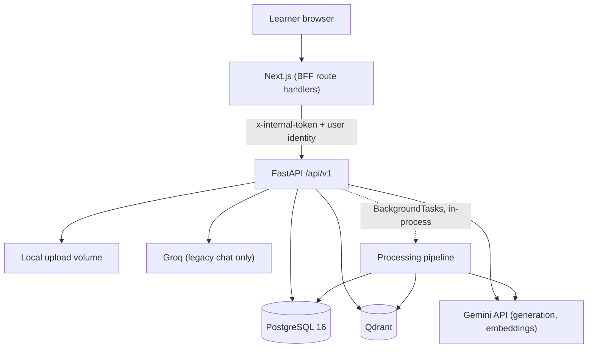
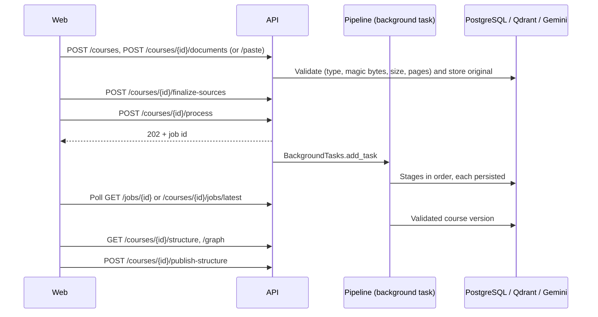
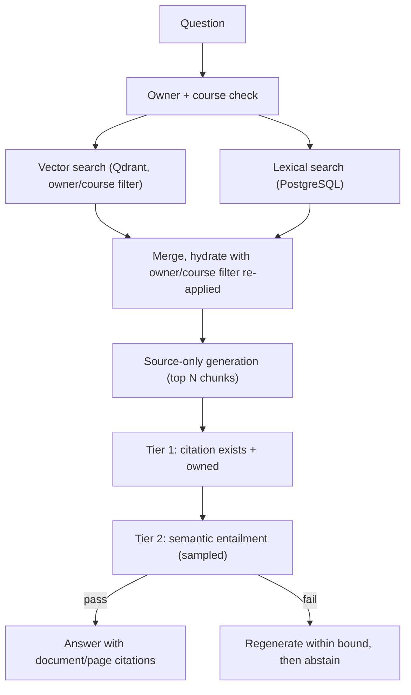
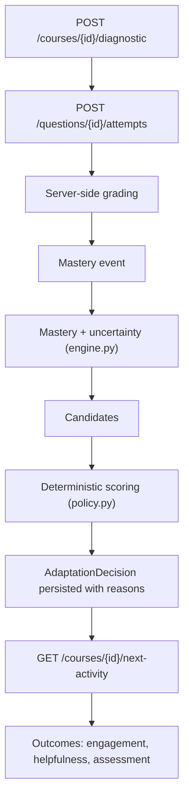
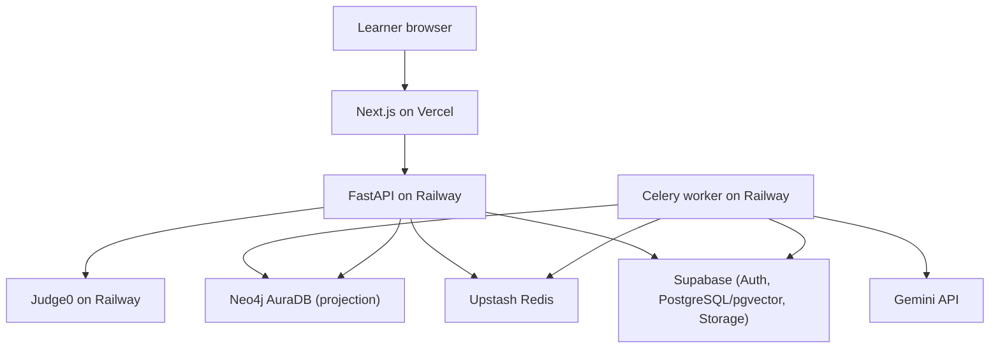

# NeuroLearn — Architecture

Last verified against the code: **2026-10-24**, by inspection of the working tree
(the test suite was not executed for this pass).

Scope split of the docs: `frozen-scope.md` owns product behavior and limits; this
file owns service boundaries, data ownership, flows, and the target topology;
`SYSTEM_ARCHITECTURE.md` owns status, known issues and invariants.

**How to read this file.** Parts 1–7 describe what the repository does **today**.
Part 8 keeps the frozen **target** design from `AGENTS.md` §5 (Supabase, Celery,
Neo4j, Judge0, Railway/Vercel). Nothing in Part 8 is implemented unless Part 1
says so. Where the two differ, `AGENTS.md` wins until a human ratifies a change;
the differences are flagged, not resolved.

## Architectural drivers

1. Execute a real upload-to-adaptation loop on unseen material.
2. Keep generated claims confined to course-owned sources.
3. Make long-running document work observable and retryable.
4. Keep recommendation selection deterministic and testable.
5. Preserve version and outcome history for evaluation.
6. Stay viable for a three-person prototype with near-zero operating cost.

---

# Part A — As built

## 1. System context and topology

| Component | Where it runs | Responsibility |
|---|---|---|
| Next.js 16 web | Docker Compose, host :3001 (or `npm run dev` :3000) | UI, NextAuth Google sign-in, route handlers that hold the internal token |
| FastAPI API | Docker Compose, host :8001 | REST API, authorization, orchestration, background pipeline |
| PostgreSQL 16 | Compose `db`, host :5433 | Authoritative product state, chunks, jobs, mastery, decisions |
| Qdrant 1.12 | Compose `qdrant`, :6333 | Derived vector index; rebuildable from PostgreSQL chunks |
| Upload volume | Compose `uploaded_documents` → `/app/var/uploads` | Original files; served only via an authenticated owner-checked endpoint |
| Gemini | External | Generation (`GEMINI_GENERATION_MODEL`, default `gemini-3.5-flash-lite`) and embeddings (`gemini-embedding-001`) |
| Groq | External | Legacy chat path only (`GROQ_MODEL`) |

There is **no** queue, worker process, object storage, graph database, code
sandbox, or deployed environment. Docker Compose is the only topology.

## 2. Trust and identity

- NextAuth (Google) authenticates the browser. On sign-in the web server calls
  `POST /auth/sync`.
- Browser calls reach the API only through Next.js route handlers or server
  components, which attach `INTERNAL_API_KEY` and the session user's email.
- FastAPI resolves identity in `app.core.security.get_current_user` from those
  trusted headers. **Known issue K-4:** anyone holding the shared token can claim
  any email; this is acceptable only while the BFF is the sole caller. Per-user
  tokens are not built.
- `INTERNAL_API_KEY` and `SECRET_KEY` are required, ≥ 32 characters, and known
  placeholders are rejected at startup (`app/core/config.py`).
- Non-owned resources return 404, never 403. Owner and course filters live inside
  service/repository queries.

## 3. Backend modules

FastAPI modular monolith, one package per domain under `backend/app/modules/`
(`models.py`, `router.py`, `schemas.py`, `service.py` where applicable). Routes
stay thin; services own logic.

| Module | Owns |
|---|---|
| `auth`, `identity` | User sync; `GET/PATCH/DELETE /me` (profile, tracking consent, account deletion); health |
| `courses` | Course lifecycle, `finalize-sources` |
| `documents` | Upload and paste, validation, chunking with provenance, owner-only content download |
| `jobs` | `processing_jobs` / `processing_stages`, start / retry / latest-job recovery, paused-with-reason state |
| `retrieval` | Course-scoped hybrid search (vector + lexical), chunk detail for citations |
| `curriculum` | Concept extraction, prerequisite edges, graph checks, modules/lessons, validation, structure edit and publish |
| `assessment` | Legacy `quiz_attempts` with server-side grading |
| `mastery` | Diagnostic question generation, grading, evidence application, mastery report |
| `adaptation` | Candidate construction, deterministic scoring, presentation affinity, decision and outcome logging |
| `tutor` | Grounded answers and lesson content with citation validation |
| `evaluation` | Experiments, conditions, cohort assignment, metrics export |
| `abuse`, `audit`, `privacy` | Per-user AI-call budget and rate limits; audit log; consent and deletion |
| `events` | `POST /events/batch` learner telemetry (suppressed under `minimal` consent) |
| `profile`, `chat`, `content` | Legacy: FSLSM vector profile, Groq chat, articles |
| `profiling` | Models only (`UserProfile`) |

Pure, infrastructure-free engines: mastery (`mastery/engine.py`), candidate
scoring and tie-break (`adaptation/policy.py`, `scoring.py`, `readiness.py`),
curriculum graph checks (`curriculum/graph.py`). They take values and return
values; persistence wraps them.

### AI gateways

Provider SDK calls sit behind interfaces in `backend/app/services/`:
`generation/` (`GenerationGateway`, Gemini, fake), `embedding/`
(`EmbeddingGateway`, Gemini, fake), `vectorstore/` (`VectorStore`, Qdrant, fake).
Tests run on the fakes and spend no quota. Model ids are settings. Outputs cross
typed Pydantic schemas before entering domain state. The legacy chat path
(`chat/router.py`, `services/adaptation.py`) still calls Groq directly (K-12), and
no call records token counts or latency (`AIUsageDaily` counts calls only).

## 4. Primary flows

### 4.1 Upload to published course

Stages run in order (`ProcessingStageName`): `VALIDATING`, `EXTRACTING`,
`CHUNKING`, `INDEXING`, `EXTRACTING_CONCEPTS`,
`BUILDING_GRAPH`, `GENERATING_STRUCTURE`, `VALIDATING_COURSE`. Job states:
`PENDING`, `RUNNING`, `READY`, `NEEDS_INPUT`, `FAILED`, `PAUSED` (provider
quota/availability; manual retry). A course version is activated only after
validation, including that every concept source resolves to a real chunk owned by
the caller.

Limits: extraction is `pypdf` text only (no OCR; scanned PDFs are not
supported); 25 MB per file; 500 pages; per-role file caps (syllabus files and at most 2 study files);
DOCX/PPTX rejected. `INTERPRETING_VISUALS` is declared in the enum but skipped
and absent from the run order; no multimodal extraction is implemented.

Durability: the pipeline runs inside the API process. If the process dies, work
stops. On startup, jobs left `PENDING`/`RUNNING` are marked `FAILED`
(`INTERRUPTED`) so a new `/process` call is not blocked.

### 4.2 Grounded retrieval and tutor

Embedding or vector-store failure degrades to lexical-only; it never widens what
is returned. Merge is by best single score, not a fused ranking, and there is no
reranker. Tier-2 entailment is sampled, not exhaustive. Retrieved text is
delimited and labeled as untrusted in every prompt (`core/prompt_safety.py`).

### 4.3 Assessment to next activity

`AdaptationDecision` (what was chosen and why, written before serving) and
`AdaptationOutcome` (what happened later) are separate tables and must stay
separate. Adaptation uses per-concept mastery and per-variant presentation
affinity; no learning-style label drives it.

All weights and thresholds are named constants with a policy version
(`mastery-v1`, `adaptive-policy-v1`, `diagnostic-v1`, `tutor-prompt-v1`) and are
**unvalidated defaults** — hand-chosen, not calibrated. No learning-gain or
quality figure exists for them. See `docs/adaptation-spec.md`.

## 5. Data ownership

PostgreSQL is the only authoritative store. Qdrant is a derived index and must be
rebuildable from `chunks`. Schema changes ship only as Alembic migrations (linear
chain, head `f7b3d29e1c64`); `create_all` is not used.

| Area | Tables |
|---|---|
| Identity / legacy | `users`, `user_profiles`, `articles`, `paragraphs`, `article_readings`, `chat_sessions`, `chat_messages` (integer keys) |
| Courses and sources | `courses`, `documents`, `chunks` (with page, heading path, char offsets), `processing_jobs`, `processing_stages` |
| Curriculum | `course_versions`, `concepts`, `concept_sources`, `concept_prerequisites`, `modules`, `lessons`, `lesson_concepts`, `assessment_blueprints` |
| Assessment and mastery | `questions`, `question_concepts`, `question_attempts`, `mastery_events`, `quiz_attempts` |
| Adaptation | `adaptation_decisions`, `adaptation_outcomes`, `presentation_affinities` |
| Tutor | `tutor_messages` |
| Governance and evaluation | `learning_events`, `ai_usage_daily`, `audit_logs`, `experiments`, `experiment_conditions`, `cohort_assignments` |

New tables use UUID keys. Per-concept mastery is derived from `mastery_events`,
not stored as its own table. Citations are validated at answer time against
`chunks`, not persisted as rows. Account deletion is explicit ordered deletes in
`PrivacyService.delete_account`; a new table must be added there by hand.

## 6. API surface (as registered)

All under `/api/v1`. FastAPI OpenAPI (`/docs`) is authoritative for payloads.

- **Identity:** `POST /auth/sync`; `GET /me`, `PATCH /me/consent`, `DELETE /me`.
- **Courses:** `POST/GET /courses`, `GET/PATCH/DELETE /courses/{id}`,
  `POST /courses/{id}/finalize-sources`.
- **Documents:** `POST /courses/{id}/documents`, `.../documents/paste`,
  `GET /courses/{id}/documents`, `GET /documents/{id}/content`.
- **Jobs:** `POST /courses/{id}/process`, `GET /jobs/{id}`,
  `GET /courses/{id}/jobs/latest`, `POST /jobs/{id}/retry`.
- **Curriculum:** `GET/PUT /courses/{id}/structure`, `GET /courses/{id}/graph`,
  `POST /courses/{id}/publish-structure`. (`PUT` graph edits: not built.)
- **Retrieval and tutor:** `GET /courses/{id}/retrieval`,
  `GET /courses/{id}/chunks/{chunkId}`, `POST /courses/{id}/tutor`,
  `GET /courses/{id}/lessons/{lessonId}/content`.
- **Mastery:** `POST /courses/{id}/diagnostic`,
  `POST /questions/{id}/attempts`, `GET /courses/{id}/mastery-report`.
- **Adaptation:** `GET /courses/{id}/next-activity`,
  `GET /courses/{id}/adaptation-history`,
  `POST /courses/{id}/adaptation-decisions/{decisionId}/outcomes/{engagement|helpfulness|assessment}`,
  `POST /presentation-affinity/{outcome|switch|reset}`.
- **Evaluation:** `POST /evaluation/experiments`,
  `GET .../experiments/{id}/conditions`, `POST .../assign`,
  `GET .../my-condition`.
- **Legacy / telemetry:** `/profile/*` (FSLSM), `/chat/*`, `/content/articles/{id}`,
  `POST /events/batch`, `POST/GET /quiz-attempts`.

Errors use RFC 7807 problem details. Generated TypeScript types from OpenAPI are
not set up; the frontend client is handwritten (`frontend/lib/api.ts`).

## 7. Security, failure model, tests

Security posture and residual risk per threat class: `docs/SECURITY.md`. Key
properties: owner filter inside every query; magic-byte and size/page limits on
uploads; no malware scanning; untrusted text delimited in all prompts (a 12-attempt
injection measurement found 0 successes on one model on one day — not a claim of
prevention); per-user AI budget, regeneration cap, burst and concurrency limits
that are **in-process** (correct for one replica only); logs must exclude
document content, answers, tokens and signed URLs.

| Failure | Behavior today |
|---|---|
| Invalid type, size or page count | Rejected before processing |
| Stage fails | Earlier stages kept; job `FAILED`; manual retry |
| Gemini quota / unavailable | Job `PAUSED` with an authored reason; manual retry |
| Citation support fails | Bounded regeneration, then abstain |
| Graph structurally invalid | Course not activated until fixed |
| Vector store or embedding error at query time | Lexical-only results |
| Process crash mid-job | Job marked `FAILED/INTERRUPTED` at next startup |
| Account deletion | Synchronous ordered delete of all owned rows; audit entry survives |

Test layers (`backend/tests/`): `unit` (pure engines, gateways, parsing),
`service` (domain services on an isolated database), `api` (routes through
`TestClient`), `security`, `evaluation`. Tests use fake gateways; the suite
database is SQLite, so PostgreSQL-only behavior (e.g. `tsvector` ranking) is not
covered by it. There are no browser tests and no frontend test runner. The last
recorded count is in `SPRINT_LOG.md`.

---

# Part B — Target design (frozen, not implemented)

Kept from the original frozen plan. Treat every item here as **designed, not
built** except where Part A already provides the equivalent.

## 8. Target topology and deviations

| Target element | Today | Gap to close |
|---|---|---|
| Supabase Auth, pgvector, Storage | NextAuth + internal token; plain PostgreSQL; Qdrant; local volume | Identity, storage and vector migration; per-user tokens (K-4) |
| Celery + Upstash Redis, idempotent stage keys | In-process `BackgroundTasks` | Durable worker; stage/artifact idempotency keys |
| Neo4j projection from committed graph versions | PostgreSQL only | Projection task and rebuild path |
| Docling + RapidOCR, Gemini multimodal fallback | `pypdf` text only | OCR and visual interpretation; scanned PDFs |
| `gemini-2.5-flash-lite` | `gemini-3.5-flash-lite` (original retired for new callers) | Ratify the model change in `AGENTS.md` |
| Judge0 isolated Python execution, hidden tests | None | Whole subsystem; highest-risk infra assumption |
| React Flow graph editor, TanStack Query, shadcn/ui | Not in `package.json`; no `PUT /graph` | Frontend and endpoint work |
| Hybrid retrieval with rerank | Vector + lexical merge, no rerank | Reranker |
| Typed OpenAPI-generated client | Handwritten client | Client generation |
| Vercel / Railway deployment | None | Deployment and its checks |
| Generated-artifact registry (model, prompt/schema version, validation state, provenance for every artifact) | Prompt-version constants and per-row fields in places; no unified `generated_artifacts` table | Unify |
| Per-call provider/model/prompt-version/token/latency logging | Call counts only | Observability (SYSTEM_ARCHITECTURE §13) |

Target-only tables from the original plan, none of which exist:
`document_pages`, `source_assets`, `chunk_embeddings`, `retrieval_traces`,
`graph_versions`, `content_gaps`, `generated_artifacts`, `citations`,
`question_validations`, `activity_instances`, `pilot_participants`,
`pilot_sessions`, `pre_post_pairs`, `simulated_profiles`, `evaluation_runs`,
`security_events`.

Target cross-store consistency (when Neo4j exists): commit the graph version and
edges in PostgreSQL; enqueue a projection keyed by graph version; upsert into
Neo4j with course, owner and version identifiers; record success in PostgreSQL;
serve traversal only from the current projected version; rebuild from PostgreSQL
on divergence. No distributed transaction.

Target Judge0 isolation: it receives only code, harness, language and limits —
no product JWT, database URL, object URL or AI key — and has no outbound network.
Its backing PostgreSQL and Redis are dedicated and never hold product data.

## 9. Acceptance criteria

Criteria for the target. Met today only where stated.

- Migrations create every table in use, and connectivity checks pass — *met for
  the built tables, by migration chain; not re-executed in this pass.*
- Ownership isolation across course, chunk, graph and evaluation access — *tests
  exist (`tests/security`, `tests/api`); coverage is per endpoint, not exhaustive.*
- Job retry does not duplicate chunks, concepts, questions or published versions
  — *not verified in this pass; check `tests/service/test_jobs_service.py`.*
- Neo4j can be deleted and rebuilt from PostgreSQL — *not applicable; no Neo4j.*
- Model output failing its schema is rejected — *implemented at the gateway
  boundary; confirmed by inspection only.*
- Judge0 cannot reach the public network or product secrets — *not applicable.*
- Two unseen document sets (one native, one scanned/visual) complete the golden
  path — *not demonstrated; the scanned/visual set is unsupported without OCR.*

## 10. External reference baseline

Provider limits and model availability are time-sensitive and have already
changed under this project (Groq and Gemini model retirements). Recheck before
deployment: Supabase pricing and pgvector docs; Upstash Redis pricing; Neo4j
AuraDB pricing; Gemini pricing, models and embeddings docs; Docling formats and
OCR engines; Railway plans; Vercel Hobby plan; Judge0 deployment docs.
